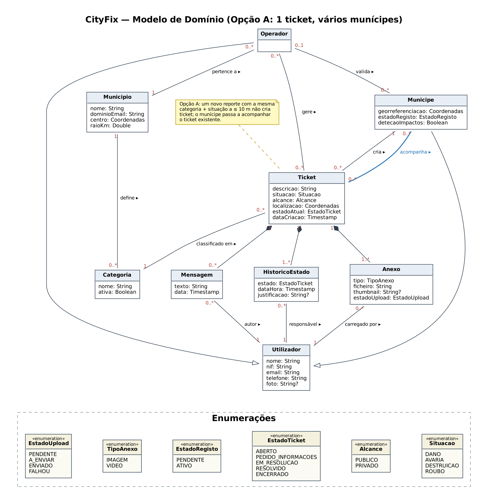

# Architecture overview

Seeded from the factory manifest (A1-A4). Update as the app takes shape.

## Components
- One Android app, Kotlin, Jetpack Compose + Material3. minSdk 24, targetSdk 37. Package `pt.isec.amov.cityfix`.
- Single Gradle module `:app`.

## Layers (MVVM)
- `ui/`: stateful screens (collect `StateFlow<UiState>`) and stateless content composables.
- `data/`: repositories over Firebase Auth, Firestore, Storage, FCM; WorkManager workers for media upload.
- `domain/`: models and pure rules (ticket lifecycle, 5-day reopen, 10 m grouping, 10 km anonymous radius, 20 m geofence).

## Domain model
Chosen model: **Option A, one ticket with several following citizens** (see [decision 0002](../decisions/0002-grouped-reports-single-ticket.md)). A report with the same category + situation within 10 m of an active ticket makes the citizen follow that ticket instead of creating a new one. There is no `Grupo` entity.

Entities: `Utilizador` (nome, nif, email, telefone, foto?) specialised into `Municipe` (georreferenciacao, estadoRegisto, detecaoImpactos) and `Operador`; `Municipio` (nome, dominioEmail, centro, raioKm) with its `Categoria`s and operators; `Ticket` (descricao, situacao, alcance, localizacao, estadoAtual, dataCriacao) composed of `Mensagem`, `HistoricoEstado` (1..*) and `Anexo` (1..*, with thumbnail and upload state). Enums: `Situacao`, `Alcance`, `EstadoTicket`, `EstadoRegisto`, `TipoAnexo`, `EstadoUpload`.

Rejected alternative, kept for the technical report: [Option B, tickets grouped by a `Grupo`](diagrams/CityFix_Dominio_OpcaoB.png).

## External services
Firebase Auth (+MFA), Cloud Firestore (offline persistence), Firebase Storage, FCM; Android location/geofencing and sensors.

## Roles
Anonymous citizen (public, active issues only, no personal data), registered citizen, municipal operator.

## References
Brief: `docs/brief/AMov.ProjetoKotlin_PT.pdf`.
