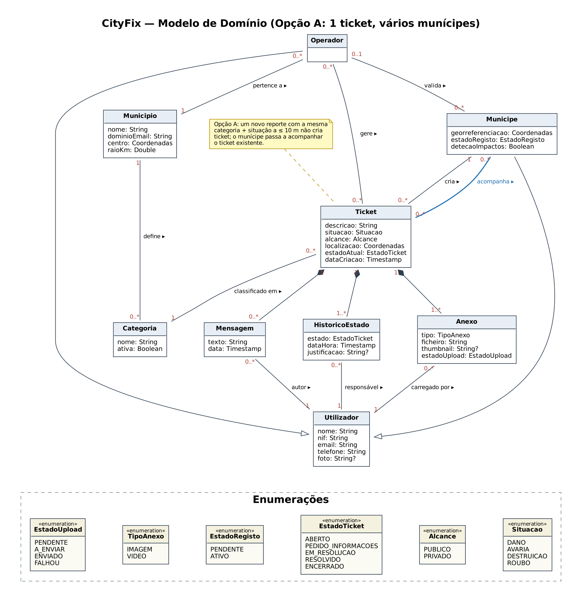
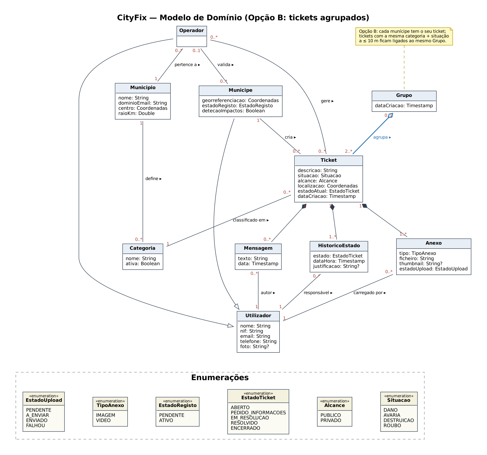

# CityFix — Relatório técnico

**Arquiteturas Móveis 2026/27**

Licenciatura em Engenharia Informática

Instituto Superior de Engenharia de Coimbra (ISEC)

Trabalho Prático Android/Kotlin

**Autores**

- Diogo Abrantes, nº 2018013532
- Francisco [apelido], nº 2018044613

**Data:** 2026-11-22

<div class="page-break"></div>

## Índice

1. Introdução
2. Arquitetura
3. Modelo de dados e esquema Firestore
4. Funcionalidades por perfil
5. Tabela de cumprimento do enunciado
6. Soluções técnicas
7. Opções de implementação e limitações
8. Oportunidades de melhoria
9. Contas de teste e como executar
10. Conclusão

<div class="page-break"></div>

## 1. Introdução

O CityFix é uma aplicação Android, escrita em Kotlin com Jetpack Compose, para participação cívica num município. Os munícipes registam, georreferenciam e acompanham ocorrências no espaço público (vias danificadas, iluminação, água, resíduos, sinalização); os operadores municipais gerem o ciclo de vida de cada ocorrência (ticket) até à sua resolução e encerramento.

A aplicação tem três perfis, como pede o enunciado (secção I):

| Perfil | Acesso | Principais funcionalidades |
| --- | --- | --- |
| Munícipe anónimo | Sem autenticação, só a menos de 10 km da Praça da República (Coimbra) | Painel com indicadores, lista de ocorrências públicas ativas, detalhe público sem dados do autor |
| Munícipe registado | Autenticado, em qualquer local | Registo com validação pelo município, abertura e acompanhamento de ocorrências, mensagens, reabertura, deteção de impactos |
| Operador municipal | Autenticado, em qualquer local | Validação de registos, categorias, painel de gestão, ciclo de vida do ticket, alerta de proximidade de 20 m |

A solução assenta no ecossistema Firebase: Authentication (e-mail/palavra-passe, verificação do telemóvel por SMS), Cloud Firestore com cache persistente para funcionamento offline, Cloud Storage para fotografias e vídeos, e WorkManager para os carregamentos e verificações em segundo plano.

### 1.1 Âmbito do relatório

Este documento responde à secção VI do enunciado: descreve as soluções técnicas adotadas, clarifica as opções de implementação concretizadas e funcionais (incluindo os desvios assumidos ao enunciado) e identifica oportunidades de melhoria. A secção 5 contém a tabela de cumprimento, item a item, das secções I a V do enunciado.

### 1.2 Organização do trabalho

O trabalho foi feito em grupo de dois. Cada autor trabalhou no seu próprio ramo Git (`dev/Diogo`, `dev/Francisco`), integrado em `main`. As tarefas foram identificadas pela inicial do autor e um contador (por exemplo `D-009` para o Diogo, `F-013` para o Francisco). Cada escolha de arquitetura relevante ficou registada numa *decision record* em `docs/decisions/` (27 registos, referidos neste texto como "decisão 00NN"); a visão técnica de pormenor está em `docs/architecture/overview.md`.

### 1.3 Pilha tecnológica

| Componente | Versão / escolha |
| --- | --- |
| Linguagem e build | Kotlin 2.2.10, Android Gradle Plugin 9.4.1, um só módulo `:app` |
| SDK | `minSdk` 24, `targetSdk` 37 |
| Interface | Jetpack Compose (BOM 2026.02.01), Material 3 1.4.0, fonte Inter |
| Navegação | Navigation Compose 2.9.8 com rotas `@Serializable` (type-safe) |
| Firebase | BoM 34.19.0: Auth, Firestore, Storage |
| Localização e mapas | `play-services-location` 21.3.0, `maps-compose` 6.1.0 |
| Imagens | Coil 3.0.4 (`coil-compose`, `coil-video`, `coil-network-okhttp`) |
| Segundo plano | WorkManager (`work-runtime-ktx` 2.12.0) |

Algumas versões não são as mais recentes de propósito: o Firebase BoM 35.x e o Coil 3.5+ exigem Kotlin 2.4, e o Navigation 2.10 exige uma versão do Compose acima do limite do projeto. A justificação está nas notas de cada tarefa.

<div class="page-break"></div>

## 2. Arquitetura

### 2.1 MVVM com ecrãs stateless e stateful

A aplicação segue MVVM, como pede o enunciado (secção V), com a separação entre composables *stateful* e *stateless*:

- **Camada de interface (`ui/`).** Cada ecrã com estado próprio tem uma função *stateful* que obtém o seu ViewModel e recolhe o `StateFlow<UiState>` com `collectAsStateWithLifecycle()`, e uma função *stateless* (`...Content`) que recebe apenas dados e devolve eventos por *callbacks*. As funções stateless são as que têm pré-visualizações (`@Preview`) em retrato, paisagem e português.
- **ViewModels (`viewmodel/`).** Cada ViewModel expõe um `StateFlow` imutável (um `MutableStateFlow` privado com `asStateFlow()`) e recebe eventos como funções simples. Os erros de validação são guardados como identificadores `@StringRes`, nunca como texto, para que o ViewModel não dependa de `Context` nem de Compose. Cada ViewModel é criado pela sua `ViewModelProvider.Factory` (o padrão do projeto Contacts das aulas práticas); os formulários que devem sobreviver à morte do processo (registo, início de sessão, perfil, alteração de credenciais) recebem um `SavedStateHandle` pelas `CreationExtras`.
- **Dados (`data/`).** Repositórios definidos por interfaces (`TicketsRepository`, `UsersRepository`, `AuthRepository`, `CategoriesRepository`, `LocationRepository`) com implementações Firebase. Toda a conversão entre documentos Firestore e modelo está em `data/FirestoreMapping.kt`; nenhum tipo Firebase sai da camada de dados.
- **Modelo (`model/`).** Entidades, enumerados e regras de negócio em Kotlin puro, sem qualquer *import* de Android ou Firebase: ciclo de vida do ticket, janela de reabertura de 5 dias, agrupamento a 10 m, raio anónimo de 10 km, geofence de 20 m, filtros do painel, eventos de notificação. Estas funções recebem o tempo atual (`now`) como parâmetro, o que as torna deterministas e fáceis de explicar e verificar à mão.
- **Utilitários (`utils/`).** Funções sem estado: distância de Haversine, validação (e-mail, telefone, NIF), formatação de datas e coordenadas, compressão de imagem, permissões de localização, canais de notificação. O código importado por `model/` (por exemplo `haversineMeters`) é Kotlin puro; a única dependência entre pacotes é `model -> utils`.

### 2.2 Estrutura de pacotes

| Pacote | Conteúdo principal |
| --- | --- |
| `pt.isec.amov.cityfix` | `MainActivity` (composable raiz `CityFixApp`), `CityFixApplication` (contentor de dependências) |
| `ui/screens/` | 22 ficheiros de ecrã: painel, listas, detalhe público, detalhe do participante, detalhe do operador, formulário de ocorrência, registo, sessão, perfil, aprovações, categorias, bloqueio de 10 km |
| `ui/components/` | Componentes reutilizáveis: `TicketCard`, `StatusBadge`, `TicketMap`, `CoarseLocationMap`, `AttachmentImage`, `AttachmentGallery`, `AttachmentViewer`, `InfoRequestCard`, `AccountFields`, `CityCard`, estados de carregamento/vazio/erro |
| `ui/navigation/` | Rotas tipadas (`Destinations.kt`), `MainTopAppBar`, barra inferior (`MainBottomBar.kt`), regras de acesso por perfil (`RoleAccess.kt`) |
| `ui/theme/` | Tema Material 3 claro e escuro, cores de estado, tipografia Inter, formas e dimensões |
| `viewmodel/` | ViewModels, `UiState` e fábricas |
| `data/` | Repositórios, mapeamento Firestore, `UploadWorker`, `ProfilePhotoWorker`, `TicketCheckWorker`, `TicketNotifier` |
| `model/` | `Ticket`, `User` (`Citizen`, `Operator`), `Category`, `Attachment`, regras puras |
| `utils/` | `Distance.kt`, `Validation.kt`, `ImageCompression.kt`, `FileUtils.kt`, `CoordinatesFormat.kt`, `Notifications.kt` |

### 2.3 Injeção de dependências manual

`CityFixApplication` (declarada em `android:name` no manifesto) é o contentor: cria por `lazy` as instâncias Firebase (`auth`, `firestore` com cache persistente, `storage`) e os repositórios. `MainActivity` obtém-na com `application as CityFixApplication` e passa-a às fábricas dos ViewModels. Não se usou Hilt nem Koin: o projeto tem poucos componentes, e uma framework de injeção acrescentaria um *plugin*, anotações e código gerado que ambos os autores teriam de explicar. É também o padrão das aulas.

### 2.4 Âmbito dos ViewModels

A mesma chamada `viewModel()` produz dois tempos de vida, conforme o `LocalViewModelStoreOwner`:

| Âmbito | ViewModels | Razão |
| --- | --- | --- |
| Atividade (acima do `NavHost`) | `SessionViewModel`, `TicketsViewModel`, `LocationGateViewModel`, `OperatorProximityViewModel`, `NotificationsViewModel`, `ImpactViewModel` | Estado partilhado por vários ecrãs; sobrevive à rotação, e os *listeners* Firestore também |
| Entrada da pilha de navegação | Formulário de ocorrência, registo, sessão, perfil, aprovações, categorias, painel e detalhe do operador | O estado do formulário sobrevive à rotação e é descartado quando o utilizador sai do ecrã |

O `TicketsViewModel` é a única fonte da lista de ocorrências: o painel, a lista pública, o painel de gestão e os detalhes leem a mesma lista, que é atualizada em tempo real por *snapshot listeners*.

### 2.5 Navegação e perfis

As rotas são classes `@Serializable` (Navigation Compose 2.8+): o compilador verifica os argumentos, e a rota do detalhe transporta apenas o identificador do ticket (`TicketDetailRoute(ticketId)`), nunca o seu conteúdo, para que o estado guardado da pilha não contenha dados pessoais.

A sessão é um tipo selado (`Session`) com os estados `Loading`, `Anonymous`, `NeedsEmailVerification`, `NeedsPhoneVerification`, `ProfileMissing`, `ProfileUnavailable` e `SignedIn(user)`. O `SessionViewModel` combina o estado do Firebase Auth com o documento `users/{uid}` (`flatMapLatest`), pelo que terminar sessão cancela o *listener* do utilizador anterior. Cada estado corresponde a um `AccessRole`, e cada papel tem o seu ecrã inicial e o seu conjunto de separadores:

| Papel (`AccessRole`) | Ecrã inicial | Separadores da barra inferior | Botão de reporte |
| --- | --- | --- | --- |
| `ANONYMOUS` | Painel | Painel, Ocorrências ativas | Não |
| `SETUP` | Configurar conta | (sem barra) | Não |
| `PENDING_CITIZEN` | Registo pendente | Painel, Ocorrências ativas, Perfil | Não |
| `CITIZEN` | Painel | Painel, Ocorrências ativas, Perfil | Sim (botão flutuante no Painel) |
| `OPERATOR` | Painel de gestão | Painel, Aprovações, Categorias, Perfil | Não ("Adicionar categoria" em Categorias) |

A proteção das rotas é feita em camadas: (1) os pontos de entrada não autorizados não são mostrados; (2) cada destino de um papel está envolvido em `RequireAccess`, que redireciona para o ecrã inicial se o papel não for permitido; (3) um único `LaunchedEffect(role)` redireciona sempre que o papel muda (início e fim de sessão, ativação pelo operador), guardando o último papel tratado em `rememberSaveable` para que a rotação não reinicie a pilha. As regras de segurança do Firestore descrevem a camada de servidor, mas não estão publicadas (secção 7).

A barra inferior (uma "ilha" flutuante Material 3) mantém uma pilha de navegação por separador (`saveState`/`restoreState`). Tocar no separador já selecionado volta à raiz desse separador ou, se já lá estiver, faz *scroll* até ao topo (secção 6.11).

### 2.6 Interface e design

O tema segue Material 3 com esquema claro e escuro (acompanha a definição do sistema), uma paleta neutra com um único acento índigo, a fonte Inter incluída na aplicação (funciona offline) e o estado de cada ticket indicado por um ponto colorido acompanhado sempre de texto (a cor nunca é o único sinal). A barra superior é dinâmica: título por destino, seta de retrocesso apenas quando existe pilha, ícone de iniciar ou terminar sessão conforme o perfil. Os botões flutuantes também são dinâmicos: "Reportar ocorrência" só para o munícipe ativo e só no Painel; "Adicionar categoria" só para o operador em Categorias.

<div class="page-break"></div>

## 3. Modelo de dados e esquema Firestore

### 3.1 Modelo de domínio: Opção A

O enunciado pede que ocorrências com a mesma tipologia/situação num raio de 10 m sejam agregadas numa "ocorrência de grupo". Foram desenhados dois modelos:

- **Opção A (escolhida):** um único ticket, com um criador e vários munícipes que o acompanham (`followerIds`). Um novo reporte que coincida com um ticket ativo não cria um ticket; o munícipe passa a acompanhar o existente.
- **Opção B (rejeitada):** um ticket por munícipe, ligados por uma entidade `Grupo`.

A Opção A foi escolhida por ser mais simples: um único ciclo de vida, um único histórico e uma única conversa por problema, sem estado de grupo a manter consistente, e o operador trabalha sobre um só ticket (decisão 0002).





O diagrama está em português e o código em inglês:

| Diagrama | Código (`model/`) |
| --- | --- |
| `Utilizador` | `sealed interface User` (id, nome, NIF, e-mail, telefone, foto) |
| `Municipe` | `data class Citizen : User` (+ georreferenciação, estado do registo, deteção de impactos) |
| `Operador` | `data class Operator : User` |
| `Municipio` | `Municipality` (nome, domínio de e-mail, centro, raio 10 km) |
| `Categoria` | `Category` (nome, ativa) |
| `Ticket` | `Ticket` (descrição, situação, alcance, localização, estado atual, data de criação, criador, seguidores) |
| `Mensagem`, `HistoricoEstado`, `Anexo` | `Message`, `StatusHistory`, `Attachment` |
| Enumerados | `TicketStatus`, `Situation`, `Scope`, `AttachmentType`, `UploadState`, `RegistrationStatus`, `AttachmentPhase` |

Escolhas de representação (decisão 0003):

- **O papel é o tipo.** `User` é uma interface selada; um `when (user)` é exaustivo e o compilador obriga a decidir cada caso. No Firestore guarda-se uma *string* `role`, convertida no mapeamento.
- **Referências por identificador.** Um ticket nunca contém nome, NIF, contactos ou morada do autor; só o `creatorId`.
- **Categoria como identificador mais nome copiado.** O ticket guarda `categoryId` e `categoryName`: a lista mostra a categoria offline, e renomear uma categoria não reescreve tickets antigos.
- **Tempos como `Long` em milissegundos UTC.** Funciona em `minSdk` 24 sem *desugaring*, e as durações são subtrações simples.
- **Alcance por omissão privado.** Um ticket que não defina o alcance nunca fica público por engano.
- **`currentStatus` duplicado de propósito** (decisão 0004). O histórico (`statusHistory`) é o registo de auditoria pedido pelo enunciado; `currentStatus` permite consultas `whereEqualTo` e indicadores sem ler o histórico. Os dois só mudam juntos, numa única função pura (`Ticket.transition`) e numa única escrita em lote.

### 3.2 Ciclo de vida do ticket

As transições estão em `model/TicketLifecycle.kt` (decisões 0011, 0018 e 0021). A interface oferece exatamente o conjunto devolvido por `allowedTransitions(utilizador, agora)`, e o repositório volta a executar `transition` antes de escrever, pelo que um ecrã desatualizado não consegue gravar uma transição inválida.

```
ABERTO --operador--> PEDIDO DE INFORMAÇÕES <--operador--> EM RESOLUÇÃO --operador + prova--> RESOLVIDO
   \--operador----------------------------------------------->/                                  |
ABERTO / EM RESOLUÇÃO --munícipe (pedido de esclarecimento)--> PEDIDO DE INFORMAÇÕES             |
RESOLVIDO --munícipe, < 5 dias, com justificação--> ABERTO                                       |
RESOLVIDO --tempo, >= 5 dias (sistema)--> ENCERRADO (bloqueado) <-------------------------------/
```

- **Ninguém encerra à mão.** O estado Encerrado resulta apenas do tempo: um ticket resolvido há 5 dias ou mais é mostrado como encerrado ("estado efetivo") e o primeiro cliente que o vê grava a entrada de encerramento, com responsável `system` e data exatamente 5 dias após a resolução.
- **Fronteira consistente:** `< 5 dias` para reabrir, `>= 5 dias` para encerrar; aos 5 dias exatos o ticket está encerrado e não é reabrível.
- **Prova de resolução.** A transição para Resolvido exige anexos novos com `phase = RESOLUTION`, acrescentados na mesma operação.
- **Pedido de informações nos dois sentidos** (enunciado II.2): o operador pede informações; o munícipe pode pedir esclarecimentos, o que também coloca o ticket em Pedido de Informações (leitura dos autores, decisão 0018). Um cartão (`InfoRequestCard`) mostra a pergunta, quem perguntou e se já foi respondida; o botão do operador diz "Retomar trabalhos" ou "Iniciar trabalhos" conforme o estado anterior (decisão 0021, adenda).

### 3.3 Esquema Firestore e Storage

O esquema está na decisão 0010. Como as regras do Firestore protegem documentos inteiros e não campos, a privacidade dos anónimos resolve-se com coleções separadas:

| Caminho | Conteúdo | Quem lê |
| --- | --- | --- |
| `users/{uid}` | papel, nome, NIF, e-mail, telefone, foto; munícipe: georreferenciação, estado do registo, deteção de impactos, validado por/em | o próprio; operadores |
| `nifs/{PAPEL}_{nif}` | `uid` | utilizadores autenticados (verificação de unicidade) |
| `municipality/main` | nome, domínio de e-mail dos operadores, centro, raio | todos |
| `categories/{id}` | nome, ativa | todos |
| `tickets/{id}` | ticket completo: descrição, situação, alcance, localização exata, estado, histórico (array), anexos (array), criador, seguidores, `participantIds` | participantes; operadores |
| `tickets/{id}/messages/{id}` | texto, data, autor, se é do município | participantes; operadores |
| `tickets/{id}/reports/{uid}` | reporte de quem se juntou por agrupamento (descrição, localização, anexos) | o próprio; operadores |
| `publicTickets/{id}` | 7 campos: categoria (id e nome), situação, estado, localização arredondada (~1 km), miniaturas, data de criação | todos, incluindo anónimos |
| `ticketLocations/{id}` | categoria, situação, localização exata, ativo | munícipes ativos e operadores (para o agrupamento) |
| `stats/summary` | 4 contadores para o painel | todos |
| Storage `tickets/{ticketId}/{uuid}.jpg`, `..._thumb.jpg` | media do ticket | público se o ticket for público; senão participantes e operadores |
| Storage `users/{uid}/photo.jpg` | foto de perfil | o próprio; operadores |

Outras opções do esquema:

- **Histórico e anexos como arrays** no documento do ticket, para que estado e histórico mudem numa só escrita; **mensagens como subcoleção**, porque crescem sem limite e nunca são lidas por anónimos.
- **`participantIds`** (criador mais seguidores): "as minhas ocorrências" é uma única consulta `whereArrayContains`.
- **Escritas em lote (batch), nunca transações, em tudo o que tem de funcionar offline**: as transações falham sem rede, os lotes ficam em fila na cache. A única transação é a do registo (unicidade do NIF), que exige rede de qualquer modo.
- **Caminhos do Storage sem identificadores de utilizador nem datas**: o nome de cada ficheiro é um UUID aleatório.

### 3.4 Projeção pública

A projeção é uma função pura, `Ticket.toAnonymousView()` (`model/TicketPrivacy.kt`), que remove `creatorId`, `followerIds`, mensagens, descrição, todo o histórico e o autor de cada anexo, e arredonda a localização a 2 casas decimais (cerca de 1 km). O documento `publicTickets/{id}` é construído só a partir dela (`toPublicTicketDocument()`), no mesmo lote que o ticket, e apenas para tickets públicos. O caminho de código dos anónimos nunca consulta `tickets` nem `ticketLocations`, pelo que a regra de privacidade é garantida na camada de dados e não apenas na interface.

Na construção desta projeção encontraram-se fugas pouco óbvias: a primeira entrada do histórico tem como responsável o criador, e a justificação de uma transição é texto livre que pode identificar o autor. Por isso a projeção descarta o histórico inteiro, e o estado mostrado vem do campo duplicado `currentStatus` (aqui a desnormalização da decisão 0004 serve também a privacidade).

### 3.5 Unicidade do NIF

O enunciado exige NIF único por tipo de perfil. O registo cria primeiro o utilizador no Firebase Auth e depois executa uma transação Firestore que lê `nifs/{PAPEL}_{nif}`: se existir, aborta; senão escreve esse documento e `users/{uid}`. Se a transação falhar, o utilizador Auth é apagado (sob `NonCancellable`, para que sair do ecrã não interrompa a limpeza). O prefixo do papel permite que um munícipe e um operador partilhem o mesmo NIF, como "único no sistema para este tipo de perfil" sugere. O NIF é validado pelo dígito de controlo (módulo 11) numa função pura (`utils/Validation.kt`).

### 3.6 Regras de segurança

Os ficheiros `firestore.rules` e `storage.rules` contêm regras completas, revistas em três rondas: apenas campos permitidos em `publicTickets`, histórico só acrescentado e nunca reescrito, transições do operador conforme a tabela da secção 3.2, janela de 5 dias medida com a hora do servidor (`resolvedAt` com `serverTimestamp()`), bloqueio total de tickets encerrados, operador só com e-mail verificado no domínio do município, agrupamento verificado por uma caixa de cerca de 11 m. **Estas regras não foram publicadas** (decisão 0012, ponto 5): a base de dados está em modo de teste. As consequências estão na secção 7.

<div class="page-break"></div>

## 4. Funcionalidades por perfil

### 4.1 Munícipe anónimo

**Bloqueio de 10 km.** No arranque a aplicação pede a localização (precisa e aproximada). Um utilizador não autenticado só acede se estiver a menos de 10 km da Praça da República; caso contrário vê um ecrã de bloqueio com "Tentar novamente" e "Iniciar sessão". Sem permissão, a mensagem inclui "Abrir definições" (único caminho após "não perguntar novamente"). O bloqueio é desenhado por cima da aplicação, que continua composta, para que "Iniciar sessão" funcione.

> **[Captura: Bloqueio de 10 km (fora da área), retrato, PT]**

**Painel.** Três indicadores: tempo médio de reparação (dias e horas, com plurais), número total de ocorrências e percentagem de ocorrências ativas. Os valores vêm do documento `stats/summary` e incluem tickets privados, porque o enunciado fala em "nº total de ocorrências". Em paisagem os três cartões ficam lado a lado.

> **[Captura: Painel (anónimo), retrato, EN]**

> **[Captura: Painel (anónimo), paisagem, PT]**

**Ocorrências ativas e lista.** O separador "Ocorrências ativas" mostra as cinco mais recentes e "Ver mais" abre a lista completa. Cada cartão mostra categoria, situação, estado e miniatura (enunciado I.1.B). Só aparecem tickets públicos e ativos (Aberto, Pedido de Informações, Em Resolução).

> **[Captura: Ocorrências ativas, retrato, PT]**

> **[Captura: Lista completa de ocorrências, paisagem, EN]**

**Detalhe público.** Categoria, situação, estado, miniaturas das fotografias e vídeos, e um mapa com zoom afastado: círculo de 750 m, sem marcador, sem gestos, centrado na localização arredondada. Não mostra autor, descrição, histórico nem coordenadas.

> **[Captura: Detalhe público (anónimo), retrato, PT]**

### 4.2 Munícipe registado

**Registo.** Nome, e-mail, telefone, NIF, palavra-passe com confirmação, georreferenciação (botão "Usar a minha localização"), foto opcional (galeria ou câmara) e o interruptor de deteção de impactos. A validação é feita em tempo real, campo a campo; o NIF é verificado pelo dígito de controlo e pela unicidade. O registo fica pendente até um operador o validar.

> **[Captura: Criar conta (munícipe), retrato, PT]**

> **[Captura: Criar conta com erros de validação, paisagem, EN]**

**Configuração da conta e sessão.** Após o registo, o ecrã "Configurar conta" pede a verificação do e-mail (ligação enviada) e depois a verificação do telemóvel por SMS. O início de sessão é por e-mail e palavra-passe; "Recuperar palavra-passe" envia o e-mail de reposição. A sessão mantém-se em cache após o primeiro início de sessão.

> **[Captura: Configurar conta (código SMS), retrato, PT]**

> **[Captura: Iniciar sessão, retrato, EN]**

> **[Captura: Recuperar palavra-passe, retrato, PT]**

**Registo pendente.** Enquanto aguarda validação, o munícipe vê um ecrã de espera e tem acesso às funcionalidades anónimas. Quando o operador ativa o registo, a aplicação muda em direto para o perfil completo, sem reiniciar, porque a sessão escuta o documento do utilizador.

> **[Captura: Registo pendente, retrato, PT]**

**Perfil.** O separador Perfil mostra foto, nome, papel, estado do registo, e-mail, telefone, NIF e, para o munícipe, a lista das suas ocorrências com o estado de cada uma. "Alterar detalhes" permite mudar o telefone, a foto e a deteção de impactos; nome, NIF e georreferenciação são apenas de leitura. O e-mail e a palavra-passe têm ecrãs próprios, com reautenticação.

> **[Captura: Perfil com as minhas ocorrências, retrato, PT]**

> **[Captura: Alterar detalhes do perfil, retrato, EN]**

**Abrir uma ocorrência.** O botão flutuante "Reportar ocorrência" abre o formulário: categoria (só as ativas), situação (Dano, Avaria, Destruição, Roubo), descrição, 1 a 3 fotografias ou vídeos (galeria ou câmara) e alcance público/privado. Todos os campos são obrigatórios e nada vem pré-selecionado. A localização exata é obtida por GPS (exige localização precisa). Ao submeter, a aplicação procura um ticket ativo da mesma categoria e situação a menos de 10 m; se existir, o munícipe passa a acompanhá-lo ("Esta ocorrência já tinha sido reportada perto daqui. Passou a acompanhá-la.").

> **[Captura: Reportar ocorrência (formulário preenchido), retrato, PT]**

> **[Captura: Reportar ocorrência em dois painéis, paisagem, EN]**

**Detalhe do participante.** Para o criador e os seguidores: mapa exato, descrição, histórico completo com datas e justificações, anexos com indicação "Envio pendente" ou "Falha no envio", e a conversa com o município. Pode pedir esclarecimentos e, até 5 dias após a resolução, reabrir com justificação. Tocar num anexo abre o visualizador em ecrã inteiro.

> **[Captura: Detalhe do participante com mensagens, retrato, PT]**

> **[Captura: Visualizador de fotografia em ecrã inteiro, paisagem, PT]**

**Deteção de impactos.** Com a opção ativa, um solavanco forte mostra uma *snackbar* "Possível buraco detetado. Reportar?"; tocar abre o formulário com Dano e Pavimento já escolhidos e a localização atual.

> **[Captura: Sugestão de reporte após impacto, retrato, PT]**

**Notificações.** O munícipe recebe notificações de mudança de estado, mensagens do município, aproximação da equipa (20 m), aviso de 24 horas antes do encerramento e encerramento. Tocar abre o ticket.

> **[Captura: Notificação de mudança de estado, retrato, PT]**

### 4.3 Operador municipal

**Registo.** Igual ao do munícipe sem georreferenciação; o e-mail tem de pertencer ao domínio do município (lido de `municipality/main`). A conta fica ativa logo após a verificação do e-mail e do telemóvel.

> **[Captura: Criar conta (operador), retrato, EN]**

**Painel de gestão.** Todas as ocorrências, públicas e privadas (estas com a etiqueta "Privada"), com filtros por estado e por categoria e ordenação por data. O filtro usa o estado efetivo, pelo que um ticket resolvido há mais de 5 dias aparece em Encerrado.

> **[Captura: Painel de gestão do operador, retrato, PT]**

> **[Captura: Painel de gestão do operador, paisagem, EN]**

**Detalhe do operador.** Mapa exato e coordenadas em texto ("Coordenadas: 40.21000, -8.41900"), contactos do autor e dos seguidores, histórico completo com o nome de quem fez cada transição, todos os anexos com "Adicionado por <nome>" e a etiqueta "Prova da resolução", e a conversa. As ações disponíveis dependem do estado: "Pedir informações" (mensagem obrigatória), "Iniciar trabalhos"/"Retomar trabalhos" (com confirmação e nota opcional), "Resolver" (1 a 3 fotografias ou vídeos de prova e nota opcional). Um ticket encerrado não tem ações nem campo de mensagem.

> **[Captura: Detalhe do operador (contactos e coordenadas), retrato, PT]**

> **[Captura: Resolver com prova, retrato, PT]**

**Validação de registos.** Lista dos munícipes pendentes (mais antigos primeiro) e detalhe com nome, NIF, mapa e coordenadas da georreferenciação, e-mail, telefone e foto. "Ativar" pede confirmação.

> **[Captura: Aprovações (lista de pendentes), retrato, PT]**

> **[Captura: Detalhe de munícipe pendente, paisagem, PT]**

**Categorias.** Criar, renomear, ativar e desativar categorias (nome obrigatório, até 40 caracteres, único sem distinguir maiúsculas). Uma categoria desativada desaparece em direto do formulário dos munícipes.

> **[Captura: Categorias com diálogo de edição, retrato, EN]**

**Alerta de proximidade.** Com a aplicação aberta e localização precisa, quando o operador entra no raio de 20 m de um ticket Em Resolução, os autores desse ticket recebem a notificação "Um operador municipal está perto desta ocorrência." (canal "Município por perto").

> **[Captura: Notificação de proximidade no telemóvel do munícipe, retrato, PT]**

<div class="page-break"></div>

## 5. Tabela de cumprimento do enunciado

Legenda: **Feito** = implementado e funcional; **Parcial** = implementado com um desvio ou limitação assumida; **Não feito** = não implementado. Os itens sem letra no enunciado foram numerados por nós pela ordem em que aparecem. O enunciado numera o operador como "2." (repetido); aqui usa-se I.3.

### I. Perfis de utilizador e gestão de permissões

| Item | Requisito | Estado | Onde / observações |
| --- | --- | --- | --- |
| I.1 | Anónimo restrito a 10 km da Pr. República | Feito | `model/AnonymousArea.kt`, `LocationGateScreen`, `LocationGateViewModel`; decisão 0014. Verificação só no cliente |
| I.1.A | Painel: tempo médio de reparação, nº total, % ativas | Feito | `DashboardScreen`, `model/DashboardStats.kt`, `stats/summary`; decisões 0005, 0013 |
| I.1.B | Lista de ocorrências públicas ativas (categoria, situação, miniatura) | Feito | `ActiveTicketsScreen`, `ListScreen`, `TicketCard`, `publicTickets` |
| I.1.C | Detalhe público sem dados pessoais nem georreferenciação, com imagens/vídeos e mapa afastado | Parcial | `ShowScreen` (PUBLIC), `CoarseLocationMap`, `model/TicketPrivacy.kt`; decisões 0006, 0007. O anónimo vê as miniaturas (256 px); um vídeo aparece como imagem de um fotograma e não é reproduzido |
| I.2 | Munícipe autenticado em qualquer local | Feito | `Session`, `RoleAccess.kt`; decisão 0015 |
| I.2.A | Registo com nome, e-mail, telefone, NIF, georreferenciação, foto opcional, deteção de impactos; NIF único; validação; pendente até validação | Feito | `RegisterScreen`, `RegisterViewModel`, `utils/Validation.kt`, transação `nifs`; decisão 0016 |
| I.2.B | E-mail/palavra-passe com MFA e recuperação por e-mail | Parcial | `LoginScreen`, `AccountSetupScreen`, `ForgotPasswordScreen`, `FirebaseAuthRepository`. O telemóvel é verificado por SMS no registo, não em cada início de sessão (decisão 0026) |
| I.2.C | Edição de perfil (nome, NIF, georreferenciação fixos) | Feito | `ProfileOverviewScreen`, `ProfileScreen`, `ChangeCredentialScreen`; decisão 0019 |
| I.2.D | Acesso às funcionalidades do anónimo | Feito | Separadores Painel e Ocorrências ativas para todos os perfis de munícipe |
| I.2.E | Abertura (categoria ativa, situação, descrição, media obrigatória, alcance) | Feito | `ReportScreen`, `ReportViewModel`, `AttachmentGallery`; decisões 0008, 0017 |
| I.2.E | Listagem das ocorrências do utilizador com estado | Feito | Lista "As minhas ocorrências" no separador Perfil (`ProfileOverviewScreen`); decisão 0018 |
| I.2.E | Detalhe com troca de mensagens | Feito | `TicketDetailScreen`, subcoleção `messages`; decisão 0018 |
| I.2.E | Reabertura até 5 dias após a conclusão | Feito | `model/TicketLifecycle.kt` (`canReopen`), `TicketDetailScreen`; decisões 0011, 0018 |
| I.2.F | Deteção de impactos no eixo vertical, com sugestão de reporte | Parcial | `utils/ImpactDetector.kt`, `ImpactViewModel`, `ImpactDetectionEffect`; decisão 0023. Usa a aceleração total, não só o eixo vertical; só com a aplicação em primeiro plano |
| I.2 Obs. | Validação automática e agrupamento a 10 m | Feito | `findNearby` (`model/TicketsList.kt`), `FirestoreTicketsRepository`, `ticketLocations`; decisões 0002, 0014. Offline compara só com a cache local |
| I.3 | Operador autenticado em qualquer local | Feito | `Session`, `RoleAccess.kt` |
| I.3.A | Registo do operador; NIF único; e-mail do domínio; ativo de imediato | Feito | `RegisterScreen`, `municipality/main.emailDomain`; decisão 0016 |
| I.3.B | E-mail/palavra-passe com MFA e recuperação por e-mail | Parcial | Como I.2.B (decisão 0026) |
| I.3.C | Edição de perfil (nome e NIF fixos) | Feito | `ProfileScreen`; decisão 0019 |
| I.3.D | Validação de registos com nome, georreferenciação e NIF | Feito | `PendingCitizensScreen`, `CitizenApprovalScreen` (mapa e coordenadas, D-021); decisão 0020 |
| I.3.E | Configuração de categorias (criar, ativar, desativar, editar); só ativas no reporte | Feito | `CategoriesScreen`, `FirestoreCategoriesRepository`; decisão 0020 |
| I.3.E | Painel de gestão: todas as participações, coordenadas, contactos, histórico com fotos e vídeos | Feito | `OperatorPanelScreen`, `OperatorTicketScreen`, `ShowScreen` (OPERATOR); decisões 0021, 0007 (adenda D-019) |
| I.3.E | Ciclo de vida: transições com data, pedido de dados, início dos trabalhos, prova em foto/vídeo | Feito | `OperatorTicketViewModel`, `TicketsRepository.startWork`/`resolveTicket`; decisão 0021. Prova por galeria (foto ou vídeo) ou câmara (só foto) |
| I.3 Obs. | Alerta aos autores quando o operador está a menos de 20 m | Parcial | `model/OperatorProximity.kt`, `OperatorProximityViewModel`, `LocationRepository.locationUpdates`; decisão 0022. Só com a aplicação do operador em primeiro plano |

### II. Ciclo de vida do ticket e regras de negócio

| Item | Requisito | Estado | Onde / observações |
| --- | --- | --- | --- |
| II.1 | Aberto ao submeter | Feito | `FirestoreTicketsRepository.reportTicket` (lote com histórico inicial) |
| II.2 | Pedido de informações pelo município e esclarecimentos pelo munícipe; a outra parte é notificada | Feito | `askForClarification`, `InfoRequestCard`, `model/InfoRequest.kt`, notificações; decisões 0018, 0021 (adenda D-018) |
| II.3 | Em resolução; ativação da geofence de 20 m e notificação aos autores | Parcial | `needsOperatorGeofence`, decisão 0022. Notificação de mudança de estado feita; a geofence só funciona com a aplicação do operador aberta |
| II.4 | Resolvido com foto/vídeo comprovativo; notificação ao autor; reabertura justificada em 5 dias | Feito | `resolveTicket`, `AttachmentPhase.RESOLUTION`, `TicketNotifier`; decisões 0011, 0021, 0024 |
| II.5 | Encerrado após 5 dias, bloqueado | Feito | `effectiveStatus`, `closeIfExpired`; decisão 0012 ponto 3. Calculado na leitura; a escrita é feita pelo primeiro cliente que vê o ticket |

### III. Sistema de notificações

| Item | Requisito | Estado | Onde / observações |
| --- | --- | --- | --- |
| III | Notificações locais | Feito | `utils/Notifications.kt` (canais), `model/TicketNotifications.kt`, `NotificationsViewModel`, `TicketCheckWorker`; decisão 0024 |
| III | Notificações remotas (push, FCM ou outra) | Não feito | FCM removido por opção dos autores (decisão 0027); não existe servidor que envie push |
| III.1 | Mudança de estado do ticket | Feito | Local: *listener* com a aplicação aberta, *worker* de 15 min com a aplicação fechada |
| III.2 | Mensagens de pedidos de informação e respostas | Feito | Campos `lastMessageAt`/`lastMessageAuthorId` no ticket |
| III.3 | Alerta de proximidade da viatura municipal (20 m) | Feito | Campo `lastOperatorNearbyAt`; depende do registo descrito em I.3 Obs. |
| III.4 | Alerta 24 h antes do fecho definitivo | Feito | Verificação temporal em cada execução; pode chegar até cerca de 15 min depois com a aplicação fechada |

### IV. Persistência de dados e serviços cloud

| Item | Requisito | Estado | Onde / observações |
| --- | --- | --- | --- |
| IV.1 | Autenticação e perfis via Firebase Authentication, sessão em cache | Feito | `FirebaseAuthRepository`, `FirestoreUsersRepository`, `SessionViewModel`; decisão 0015 |
| IV.2 | Firestore com cache persistente para leitura e escrita offline | Feito | `CityFixApplication` (`persistentCacheSettings`), lotes não aguardados; decisões 0010, 0013 |
| IV.3 | Compressão local de imagens e carregamento via WorkManager condicionado à rede | Feito | `utils/ImageCompression.kt`, `AttachmentUploader`, `UploadWorker`, `ProfilePhotoWorker`; decisão 0017. Os vídeos são carregados sem compressão |

### V. Notas sobre o desenvolvimento

| Item | Requisito | Estado | Onde / observações |
| --- | --- | --- | --- |
| V.1 | Jetpack Compose | Feito | Toda a interface em Compose (Material 3) |
| V.2 | Informação partilhada na cloud (Firebase) | Feito | Firestore e Storage |
| V.3 | Permissões dinâmicas: localização em primeiro e segundo plano, câmara, notificações | Parcial | Localização em primeiro plano e notificações pedidas em tempo de execução, com recuperação após recusa. Câmara via aplicação do sistema (`TakePicture`), que não precisa de permissão. **Localização em segundo plano não pedida** (decisão 0022) |
| V.4 | Otimização, compressão e miniaturas antes do envio | Feito | 1600 px JPEG 80 e miniatura 256 px; decisão 0017 |
| V.5 | Inglês por omissão, outra língua pelo dispositivo | Feito | `values/strings.xml` (EN), `values-pt/strings.xml` (PT); 341 chaves traduzíveis em cada língua |
| V.6 | Retrato e paisagem sem perda de funcionamento | Feito | Estado em ViewModels, `SavedStateHandle` e `rememberSaveable`; dois painéis em paisagem no detalhe e no formulário |
| V.7 | Navegação fácil; ícones, barras e botões flutuantes dinâmicos | Feito | Barra inferior por perfil, barra superior por destino, botões flutuantes por perfil e ecrã |
| V.8 | Mecanismos de acessibilidade | Feito | Descrições de conteúdo, alvos de 48 dp, títulos semânticos, grupos de seleção, regiões *live*; verificado com TalkBack à mão (sem Accessibility Scanner) |
| V.9 | Organização, qualidade, robustez; MVVM com stateless/stateful | Feito | Secção 2; regras puras em `model/` |

<div class="page-break"></div>

## 6. Soluções técnicas

### 6.1 Funcionamento offline

- **Cache persistente do Firestore** definida explicitamente em `CityFixApplication` (`persistentCacheSettings`), aplicada antes de qualquer outra chamada.
- **Escritas não aguardadas.** Reportar, mudar de estado, enviar mensagens, editar o perfil, ativar registos e gerir categorias são lotes ou escritas simples que não fazem `await()` do `commit()`: o `commit()` só termina quando o servidor confirma, o que deixaria o formulário bloqueado offline. A escrita entra na cache, o *snapshot listener* mostra-a de imediato e o Firestore envia-a quando houver rede. O identificador de um novo ticket é gerado localmente (`collection("tickets").document()`).
- **Leituras em tempo real.** Os *listeners* são expostos como `Flow` com `callbackFlow { ... awaitClose { registration.remove() } }` e recolhidos no `viewModelScope`; o *listener* é removido quando o ViewModel é destruído, e uma alteração num dispositivo aparece noutro sem atualização manual.
- **Contadores do painel sem servidor.** Os anónimos não podem ler tickets privados, mas o painel conta-os. Os quatro contadores de `stats/summary` mudam no mesmo lote que o ticket, com `FieldValue.increment`. O incremento é calculado pela mesma regra pura dos indicadores (`statsIncrements(antes, depois)`), por isso as definições de "ativo" e de "tempo de reparação" existem uma só vez. Os incrementos funcionam offline e não se sobrepõem entre dispositivos.
- **Agrupamento offline.** A consulta a `ticketLocations` responde a partir da cache quando não há rede.

### 6.2 Carregamentos com WorkManager

- Após o lote do ticket, é colocado em fila um `OneTimeWorkRequest` por documento (ticket ou reporte de quem se juntou), com restrição de rede e *backoff* exponencial a partir de 30 s.
- O `UploadWorker` (`CoroutineWorker`) carrega cada ficheiro pendente e a sua miniatura para o Storage (`putFile`, `downloadUrl`), grava o URL e o estado `UPLOADED` na entrada do array, e apaga as cópias locais. O trabalho sobrevive ao fecho da aplicação e ao reinício do telemóvel.
- **Um *worker* por documento.** O Firestore não altera um elemento de um array; o *worker* lê o documento, substitui a entrada e volta a escrever. Na primeira versão havia um *worker* por anexo, e dois em paralelo sobrescreviam-se (encontrado na revisão). Com um por documento, as escritas são sequenciais.
- **Falhas.** Uma exceção devolve `Result.retry()`; ao fim de 5 tentativas as entradas restantes ficam `FAILED` e o detalhe mostra "Falhou o carregamento".
- **Cada dispositivo só carrega os seus ficheiros** (entradas pendentes cujo ficheiro existe localmente), pelo que a prova de resolução do operador não interfere com os anexos pendentes do munícipe.
- Para tickets públicos, o URL de cada miniatura é acrescentado a `publicTickets.thumbnails` com `FieldValue.arrayUnion`.
- A foto de perfil usa um *worker* próprio com trabalho único por utilizador (`enqueueUniqueWork(..., REPLACE)`), para que duas gravações rápidas não terminem pela ordem errada; como o caminho no Storage é sempre o mesmo, a chave da cache do Coil inclui `photoUpdatedAt`.

### 6.3 Compressão de imagens

- Cada fotografia é comprimida no dispositivo, ao submeter: leitura das dimensões (`inJustDecodeBounds`), descodificação reduzida (`inSampleSize`, potência de 2) para nunca carregar uma fotografia de 12 MP inteira em memória, rotação conforme o EXIF, escala para um lado maior de 1600 px e gravação em JPEG qualidade 80. A miniatura tem 256 px (JPEG 70).
- A recodificação produz um ficheiro **sem EXIF**, o que remove a posição GPS, o modelo da câmara e a hora de captura das fotografias publicadas.
- Os vídeos recebem uma miniatura a partir de um fotograma (`MediaMetadataRetriever`) e são carregados tal como gravados.
- Comprimir ao submeter e não no *worker* foi uma escolha deliberada: caso contrário, o ticket guardaria primeiro o original grande, com o EXIF, e os caminhos mudariam depois do lote.

### 6.4 Localização

- **Uma leitura de GPS quando é precisa.** `LocationRepository.currentLocation()` usa `getCurrentLocation(PRIORITY_HIGH_ACCURACY)` com `await()`; devolve `null` sem permissão ou sem posição, e nunca lança `SecurityException`.
- **Permissões no arranque**, como nas aulas: `RequestMultiplePermissions` para FINE e COARSE. Uma recusa nunca faz a aplicação falhar.
- **Localização precisa para reportar.** No Android 12+ o utilizador pode conceder só a localização aproximada (cerca de 2 km, alinhada numa grelha). Dois reportes não relacionados na mesma célula ficariam com o mesmo ponto e seriam agrupados (encontrado na revisão), por isso o formulário exige localização precisa; o bloqueio de 10 km aceita a aproximada.
- **Mapas** com `maps-compose`: mapa exato com marcador (zoom 15) para participantes e operadores; mapa afastado com círculo de 750 m e gestos desligados para anónimos. A localização pública tem 2 casas decimais (até cerca de 700 m de deslocação), daí o círculo de 750 m. O mapa exato está dentro de uma página com *scroll*: o mapa deteta o toque (`pointerInput` na fase *Initial*) e a página desliga o seu *scroll* enquanto houver um dedo no mapa, para que o zoom com dois dedos funcione.

### 6.5 Agrupamento a 10 m

- A distância é calculada com a fórmula de Haversine (raio médio da Terra de 6 371 km), em `utils/Distance.kt`, reutilizada pelo raio de 10 km e pela geofence de 20 m. O valor intermédio é limitado a 0..1 para nunca dar `NaN`.
- Regra de correspondência (`findNearby`): mesma categoria e situação, ticket ativo, distância até 10 m inclusive, ganha o mais próximo, qualquer alcance. A posição (0, 0) nunca corresponde, porque significa "não definida".
- O Firestore filtra `ticketLocations` por categoria, situação e `active` (três igualdades, sem índice composto); o teste de 10 m corre na aplicação sobre esses poucos documentos. Geohash e caixas de latitude/longitude foram rejeitados por exigirem campos novos ou índices compostos.
- Se o munícipe já participa no ticket encontrado, nada é escrito ("Já acompanha esta ocorrência"). Caso contrário, um lote grava o seu reporte em `tickets/{id}/reports/{uid}` e acrescenta o seu `uid` a `followerIds` e `participantIds` com `FieldValue.arrayUnion`, o que torna a junção idempotente.
- **Media de quem se junta.** O agrupamento ignora o alcance (o enunciado só fala de tipologia, situação e 10 m), pelo que um reporte privado pode juntar-se a um ticket público, cujas imagens os anónimos veem. Por isso a descrição e as fotografias de quem se junta ficam no seu próprio documento `reports/{uid}`, visível apenas para si e para os operadores.

### 6.6 Geofence de 20 m

- A localização contínua do operador é um `Flow` (`callbackFlow` sobre `requestLocationUpdates`, intervalo de 5 s, mínimo 2 s) recolhido dentro de `repeatOnLifecycle(STARTED)`: o GPS só está ligado com a aplicação em primeiro plano, e cancelar a recolha é a única operação de paragem necessária.
- Em cada posição, Haversine contra cada ticket que `needsOperatorGeofence` (efetivamente Em Resolução e com localização real), inclusivo a 20 m. Posições com precisão pior do que 25 m são descartadas.
- **Só a entrada conta.** Grava-se apenas a passagem de fora para dentro; o campo `lastOperatorNearbyAt` funciona como limitador de 1 hora partilhado por todos os operadores, e um mapa em memória cobre o intervalo até a cache devolver a escrita. O estado de entrada vive num ViewModel, pelo que a rotação não conta como nova entrada.
- **Um único campo como ligação às notificações.** Os munícipes já escutam os seus tickets, por isso um campo no ticket chega-lhes sem novo *listener*, consulta ou regra. Só se guarda uma hora: nem o identificador do operador nem coordenadas saem do seu dispositivo.
- A comparação entre a Geofencing API do Android e esta solução está na secção 7.3.

### 6.7 Sensores: deteção de impactos

- `utils/ImpactDetector` regista o acelerómetro (`TYPE_ACCELEROMETER`, `SENSOR_DELAY_GAME`), como o `PotholeDetector` das aulas. É detido pelo `ImpactViewModel`; o composable `ImpactDetectionEffect` apenas indica quando iniciar (ON_START) e parar (ON_STOP).
- Um impacto é uma aceleração total `sqrt(x² + y² + z²)` fora de 6..14 m/s², com um intervalo mínimo de 30 s entre sugestões.
- Só corre para munícipes ativos com a opção ligada; guardar a opção no perfil liga ou desliga o detetor através da sessão, sem código adicional. Não precisa de permissão.
- A sugestão nunca cria um reporte automaticamente: abre o formulário com Dano e a categoria `pavement` pré-escolhidos (`ReportTicketRoute(fromImpact = true)`). Não é mostrada se o formulário já estiver aberto.

### 6.8 Notificações locais

- **Sem servidor** (decisões 0012, 0024, 0027): a aplicação compara os tickets que lê com uma hora de "última verificação" guardada por utilizador (`SharedPreferences`) e mostra notificações locais.
- **Com a aplicação aberta:** um *listener* próprio que só aceita listas confirmadas pelo servidor (ignora `isFromCache`), para que dados da cache nunca avancem a hora da última verificação.
- **Com a aplicação fechada:** `TicketCheckWorker`, trabalho periódico único de 15 minutos com restrição de rede, que lê com `Source.SERVER`. É agendado quando a sessão conhece o utilizador e cancelado ao terminar sessão.
- **Regra pura** `Ticket.eventsFor(utilizador, éOperador, desde, agora)` em `model/`: mudança de estado, mensagem, operador perto, aviso de 24 horas, encerramento; nunca as ações do próprio utilizador. O munícipe é notificado dos tickets em que participa; o operador das ações dos munícipes.
- **Mensagens:** cada envio grava também `lastMessageAt` e `lastMessageAuthorId` no ticket, no mesmo lote, para o *listener* dos tickets as detetar.
- Três canais (ocorrências, mensagens, proximidade); a permissão `POST_NOTIFICATIONS` é pedida no Android 13+. O identificador da notificação é `(ticketId + tipo).hashCode()`, para que a aplicação e o *worker* se substituam em vez de duplicarem. Tocar abre o ticket (`singleTop` + `onNewIntent`). Terminar sessão limpa a área de notificações. O título é a categoria; nunca há coordenadas nem dados do operador.

### 6.9 Autenticação e SMS

- **E-mail e palavra-passe** com Firebase Auth; recuperação por e-mail (`sendPasswordResetEmail`).
- **Configuração da conta:** verificação do e-mail (ligação, depois `reload()` e renovação do *token*) e verificação do telemóvel por SMS. Desde a decisão 0026 o telemóvel é **ligado** à conta (`linkWithCredential`), não inscrito como segundo fator; o início de sessão pede só e-mail e palavra-passe. As contas criadas antes desta decisão mantêm o fator inscrito e o passo de SMS no início de sessão (`MfaScreen`), que continua implementado com o `MultiFactorResolver`.
- **Callbacks convertidos em suspensão.** As *callbacks* de `verifyPhoneNumber` estão envolvidas em `suspendCancellableCoroutine` dentro de `withTimeoutOrNull(60 s)`: uma *callback* perdida (por exemplo numa rotação) torna-se um tempo esgotado com a opção de reenviar o código, e não um bloqueio. Uma verificação automática do número (`onVerificationCompleted`) liga o telefone de imediato.
- Testes com números de teste da consola Firebase (códigos fixos, sem custo de SMS).
- **Registo resistente a cancelamento.** Durante o registo, um indicador `holdRedirect` impede o redirecionamento automático (o Firebase inicia sessão logo ao criar o utilizador), o botão Retroceder é ignorado, e a limpeza após falha corre sob `NonCancellable`. Sem isto, sair a meio podia deixar uma conta órfã ou um NIF reservado (encontrado na revisão).
- A alteração de e-mail (`verifyBeforeUpdateEmail`) e de palavra-passe exige reautenticação. A cópia do e-mail em `users/{uid}` é sincronizada pela sessão no primeiro *snapshot* após cada início de sessão; comparar em todos os *snapshots* criava ciclos entre dispositivos (encontrado na revisão).

### 6.10 Visualizador de media

- Tocar num anexo do detalhe abre `AttachmentViewer`, um `Dialog` em ecrã inteiro com fundo preto.
- Fotografias com Coil (`ContentScale.Fit`) e zoom com dois dedos de 1x a 5x (`detectTransformGestures` e `graphicsLayer`).
- Vídeos com o `VideoView` da plataforma dentro de `AndroidView`, com `MediaController` para reproduzir, pausar e avançar; parado em `onRelease`. Escolheu-se `VideoView` em vez do Media3 para não acrescentar dependências.
- Um URL https é usado diretamente; um ficheiro local (antes do carregamento) é passado como `file://`. Um erro mostra uma mensagem própria. O anexo aberto é guardado em `rememberSaveable`, pelo que o visualizador sobrevive à rotação.
- No detalhe do operador, cada anexo indica quem o acrescentou ("Adicionado por <nome>") a partir de `Attachment.uploadedById`, já gravado desde o início (D-019).

### 6.11 Navegação e privacidade ao terminar sessão

A barra inferior guarda uma pilha por separador. Na verificação manual do operador encontrou-se um erro (D-020): Painel, detalhe, Perfil e de volta ao Painel mostrava o detalhe com o Perfil destacado, e tocar em Painel não saía do detalhe. A correção acrescentou duas regras ao padrão `saveState`/`restoreState`: o separador destacado é o último mostrado **ou tocado**, e tocar no separador já selecionado volta explicitamente à sua raiz (ou faz *scroll* até ao topo, através de um `MutableSharedFlow` sem *replay*).

A revisão dessa correção encontrou um problema de privacidade (B1) existente desde a introdução da barra: terminar sessão limpava só a pilha visível. As pilhas guardadas dos separadores, e os ViewModels associados às suas entradas, sobreviviam; como `viewModel(factory = ...)` ignora a fábrica quando já existe um ViewModel, um segundo utilizador no mesmo dispositivo podia receber o `ProfileViewModel` do anterior (nome, NIF, e-mail, telefone), um rascunho de reporte ou o detalhe de um operador. **Correção:** todas as chamadas `viewModel(...)` dependentes do utilizador passaram a ter uma chave com o seu identificador (`profile-<uid>`, `report-<citizenId>`, `ticket-detail-<uid>`, `operator-ticket-<uid>`, `approval-<operatorId>`, `credential-<uid>`). Uma entrada restaurada de outro utilizador cria um ViewModel novo; o mesmo utilizador mantém o seu. A chave foi preferida a limpar as pilhas guardadas porque não depende de onde a biblioteca de navegação as guarda e cobre também mudanças de papel e redirecionamentos.

Antes disso, a função de terminar sessão já limpava a lista de tickets (`setUser(null)`) **antes** de `signOut()`, para que a primeira imagem após o fim de sessão nunca mostre tickets do utilizador anterior.

### 6.12 Coordenadas

- No detalhe do operador (D-019) e no detalhe de um munícipe pendente (D-021), a localização exata é mostrada como mapa **e** texto: "Coordenadas: 40.21000, -8.41900". A posição (0, 0) mostra "Localização indisponível" e nenhuma linha.
- Há um único formatador (`utils/CoordinatesFormat.kt`): `Locale.ROOT` com 5 casas decimais (cerca de 1 m). Em português a vírgula decimal confundir-se-ia com a vírgula entre latitude e longitude; por isso todas as coordenadas da aplicação usam ponto, incluindo a localização própria no registo, no formulário e no perfil. O TalkBack lê "Latitude x, longitude y".
- As coordenadas de terceiros em texto só aparecem nas vistas do operador; os anónimos recebem a localização já arredondada na camada de dados.

### 6.13 Privacidade em camadas (resumo)

1. **Filtro de documentos:** os anónimos só leem `publicTickets` (tickets públicos e ativos).
2. **Projeção de campos:** `toAnonymousView()` antes de escrever `publicTickets`; 7 campos permitidos.
3. **Interface por audiência:** `ShowScreen` recebe uma `DetailAudience` (PUBLIC, REGISTERED, OPERATOR) com `when` exaustivo; a audiência é decidida por quem chama, conforme o papel e a relação com o ticket.
4. **Ficheiros:** caminhos sem identificadores; fotografias sem EXIF.
5. **ViewModels por utilizador** e limpeza da lista ao terminar sessão.

<div class="page-break"></div>

## 7. Opções de implementação e limitações

Esta secção enumera, com franqueza, as escolhas que se afastam do enunciado ou que limitam a solução, e o motivo de cada uma.

### 7.1 Desvios assumidos ao enunciado

| Tema | Enunciado | Implementado | Motivo | Decisão |
| --- | --- | --- | --- | --- |
| MFA | Duplo fator em cada autenticação (I.2.B, I.3.B) | Telemóvel verificado por SMS uma vez, no registo; início de sessão só com e-mail e palavra-passe | O Firebase pede o código SMS em **cada** início de sessão e reautenticação, sem opção para o evitar; nos testes isso revelou-se cansativo. Contas antigas mantêm o fator | 0026 |
| Notificações remotas | Locais e remotas (push) (III) | Só locais: *listener* com a aplicação aberta e *worker* de 15 min com a aplicação fechada | Enviar push exige código de servidor (Cloud Functions em JS/TS), uma segunda linguagem e um processo de publicação que ambos os autores teriam de defender. O FCM chegou a existir apenas para receber uma mensagem de teste da consola e foi retirado | 0012, 0024, 0027 |
| Geofence de 20 m | Alerta sempre que o operador se aproxima; permissão de localização em segundo plano (V) | Só com a aplicação do operador em primeiro plano; sem `ACCESS_BACKGROUND_LOCATION` | Precisão e simplicidade (tabela 7.3) | 0022 |
| Deteção de impactos | Aceleração no eixo vertical (I.2.F) | Aceleração total, fora de 6..14 m/s² | Com o telemóvel na vertical o eixo Z mede cerca de 0, abaixo de 6, e a regra do eixo Z disparava continuamente no emulador. A aceleração total é cerca de 9,8 em repouso em qualquer posição. Custo: reage também a solavancos não verticais (por exemplo pousar o telemóvel com força) | 0023 |
| Media para anónimos | Imagens e/ou vídeos (I.1.C) | Miniaturas de 256 px; vídeos como imagem de um fotograma | `publicTickets` guarda só miniaturas; servir os ficheiros completos é uma melhoria | 0010, 0017 |

### 7.2 Firebase: plano, regras e servidor

- **Plano Blaze com alerta de orçamento, e não Spark.** Desde 30-10-2024 criar o *bucket* do Storage exige Blaze, e a 03-02-2026 os projetos Spark perderam o acesso aos *buckets*. Sem Storage não haveria fotografias nem vídeos. O projeto fica dentro das quotas gratuitas; o alerta de orçamento é a proteção de custos (decisão 0012).
- **Sem Cloud Functions** (decisão 0012). Consequências: não há push; o encerramento aos 5 dias é calculado na leitura e gravado pelo primeiro cliente que vê o ticket; os contadores do painel são mantidos pelos próprios clientes; o limitador da geofence é do lado do cliente.
- **Regras de segurança redigidas mas não publicadas** (decisão 0012, ponto 5). A base de dados está em modo de teste até [data de expiração: 2026-12-10 ou 2027-03-01, confirmar na consola]. Por isso, nesta entrega, a privacidade dos anónimos, os papéis, a imutabilidade de nome e NIF e o MFA são garantidos **apenas pela aplicação** (consultas por audiência, projeção, guardas de navegação, uma única via de escrita por operação). Qualquer cliente com a configuração do projeto poderia escrever diretamente. Foi uma escolha consciente para um projeto académico que não irá para produção; as regras redigidas documentam como o servidor garantiria cada requisito, e publicá-las é a primeira melhoria. Algumas escritas acrescentadas depois (por exemplo `lastOperatorNearbyAt`, `lastMessageAt`, a resolução sem `resolvedAt`) seriam recusadas pelas regras redigidas e exigiriam ajustes antes de publicar.
- **O raio de 10 km é verificado só no cliente**: os pedidos anónimos não transportam localização.
- **Chave do Google Maps no manifesto**, por escolha explícita, para que o mapa funcione na compilação do avaliador (o `local.properties`, excluído do ZIP, não serviria). Quem tiver o ZIP pode usar a chave; a restrição à API Maps SDK e o alerta de orçamento limitam o risco. A chave não pode ter restrição por pacote e SHA-1, porque a compilação do avaliador é assinada com outra chave de *debug*.
- `google-services.json` não está no Git; é acrescentado ao ZIP à mão (decisão 0025).

### 7.3 Geofence: Geofencing API versus Flow em primeiro plano

| | Geofencing API do Android | Flow em primeiro plano com Haversine (escolhido) |
| --- | --- | --- |
| Aplicação fechada ou ecrã desligado | Funciona | Não funciona |
| Precisão a 20 m | Fraca: a Google recomenda raios de pelo menos 100-150 m | Distância exata em cada posição; posições imprecisas descartadas |
| Latência de entrada | Cerca de 2-3 minutos | Um intervalo (cerca de 5 s) |
| Permissão | `ACCESS_BACKGROUND_LOCATION` ("Permitir sempre") | Só localização precisa, já pedida no arranque |
| Ciclo de vida | Registar e remover a cada alteração da lista, fim de sessão, reinício e atualização | Um Flow sob `repeatOnLifecycle` |
| Testes no emulador | Com atraso | `adb emu geo fix`, imediato |

A solução híbrida (Geofencing API por cima, a chamar a mesma regra pura e a mesma escrita) fica como melhoria. Limitação adicional: uma chegada feita com a aplicação em segundo plano não conta, porque só se regista uma entrada se o operador tiver sido visto fora do círculo com a aplicação aberta.

### 7.4 Outras limitações

- **Agrupamento:** a precisão do GPS (3 a 10 m) é da mesma ordem que a regra de 10 m; dois reportes do mesmo problema podem não coincidir e dois problemas próximos podem agrupar. Offline, o agrupamento só vê os tickets na cache local, pelo que podem surgir duplicados. Os munícipes ativos podem ler a localização exata, categoria e situação de todos os tickets em `ticketLocations` (sem autor, descrição nem media), um custo aceite da Opção A.
- **Notificações:** com a aplicação fechada podem chegar até cerca de 15 minutos depois (mais em modo Doze), incluindo o aviso de 24 horas; relógios de dispositivos desacertados podem fazer perder um evento.
- **Concorrência:** mudanças de estado simultâneas são "a última escrita ganha" (sem transações, para funcionar offline).
- **Vídeos:** não são comprimidos nem limitados em tamanho e mantêm os metadados de gravação (possivelmente o local). O WorkManager interrompe um *worker* ao fim de cerca de 10 minutos, pelo que um vídeo muito grande numa rede lenta pode nunca terminar.
- **Registo:** se a rede falhar entre a criação do utilizador Auth e a transação, pode ficar uma conta sem perfil (o utilizador vê o ecrã de problema na conta e o e-mail só volta a poder ser usado depois de apagar o utilizador na consola). Registo e início de sessão exigem rede; só uma sessão já em cache funciona offline.
- **Munícipes pendentes não estão sujeitos ao limite de 10 km** (leitura literal de I.1, que limita apenas o utilizador não autenticado).
- **Não implementado por opção:** rejeição de registos (um registo errado fica pendente), eliminação de categorias (desativar é a eliminação segura), alteração do telemóvel de verificação, remoção da foto de perfil, mapa no painel de gestão, reportes de quem se juntou no detalhe do operador, gravação de vídeo pela câmara (vídeos só pela galeria).
- **Formulários:** o rascunho de reporte e a prova de resolução sobrevivem à rotação mas perdem-se se o sistema terminar o processo.
- **Nomes de categorias** são dados escritos pelos operadores e não são traduzidos.
- **Testes:** não há testes automáticos (não exigidos). Cada fatia de código foi verificada com `./gradlew assembleDebug` e `./gradlew lint` (0 erros; 17 avisos aceites, quase todos sobre versões mais recentes de bibliotecas) e revista por um agente de revisão; o comportamento foi verificado à mão segundo `docs/testing/manual-test-checklist.md`, que segue as secções do enunciado.

<div class="page-break"></div>

## 8. Oportunidades de melhoria

### 8.1 Servidor e segurança

- **Publicar as regras de segurança** depois de as ajustar às escritas atuais, e testá-las com o Firebase Emulator Suite (`@firebase/rules-unit-testing`), cobrindo cada caso permitido e recusado que as revisões verificaram à mão.
- **App Check**, para que só a aplicação verdadeira use a configuração do projeto.
- **Cloud Functions** para: push FCM em mudanças de estado e mensagens (sem o atraso de 15 min); encerramento agendado aos 5 dias; agrupamento no servidor com o círculo exato (evita duplicados criados offline); recálculo periódico de `stats/summary`; registo atómico (utilizador e perfil num só passo, `nifs` ilegível pelos clientes); imposição do domínio do operador no e-mail Auth.

### 8.2 Funcionalidades

- **MFA opcional** que o utilizador possa ativar no perfil (inscrever o telemóvel já ligado como segundo fator), e um segundo fator de reserva (TOTP) para não perder a conta com o telemóvel.
- **Geofence em segundo plano:** Geofencing API em modo híbrido, com uma explicação própria antes de pedir "Permitir sempre", ou um serviço em primeiro plano enquanto o operador está "de serviço"; intervalos adaptativos para poupar bateria.
- **Deteção de impactos:** usar apenas a componente vertical (projeção sobre a gravidade), exigir movimento (velocidade GPS) para excluir quedas do telemóvel parado, limiar configurável e deteção com a aplicação fechada.
- **Media:** transcodificação de vídeo (reduz o tamanho e remove metadados), media completa para anónimos, botão para repetir carregamentos falhados e indicação de progresso (`setProgress`), gravação de vídeo pela câmara, deslizar entre anexos no visualizador.
- **Operador:** mapa no painel com agrupamento de marcadores, atribuição de tickets a operadores, ligação direta para telefone e e-mail, contagens por estado nos filtros, rejeição de registos com motivo, mostrar os reportes de quem se juntou.
- **Munícipe:** escolher a georreferenciação num mapa no registo, contadores de mensagens não lidas, paginação de conversas longas, indicação de mensagens ainda por enviar (`hasPendingWrites`).

### 8.3 Qualidade e interface

- **Testes automáticos:** JUnit para as regras puras de `model/` (ciclo de vida, agrupamento, indicadores, eventos de notificação), que já estão isoladas de Android; testes de interface para rotação e TalkBack.
- **Rascunhos em `SavedStateHandle`** (formulário de reporte e prova de resolução), para sobreviverem à morte do processo.
- **Layouts adaptativos** com `WindowSizeClass` para tablets e listas em duas colunas em paisagem; grafos de navegação aninhados por separador.
- **Nomes de categorias por língua**; descrição acessível própria para o mapa (hoje o rótulo vem do SDK do Maps).
- **Atualização conjunta** de Kotlin 2.4, Firebase BoM 35, Coil e Navigation 2.10.

<div class="page-break"></div>

## 9. Contas de teste e como executar

### 9.1 Contas de teste

As contas abaixo existem no projeto Firebase usado na entrega. Os números de telefone são números de teste definidos na consola Firebase (Authentication, método Telefone), com código fixo; não é enviado SMS real. Nenhuma destas palavras-passe é usada noutros serviços.

| Perfil | E-mail | Palavra-passe | Telefone de teste | Código fixo | O que experimentar |
| --- | --- | --- | --- | --- | --- |
| Munícipe ativo | [preencher] | [preencher] | [preencher] | [preencher] | Reportar com fotografia, As minhas ocorrências (Perfil), conversa, pedido de esclarecimento, reabertura, editar perfil, sugestão de impacto |
| Munícipe pendente | [preencher] | [preencher] | [preencher] | [preencher] | Ecrã de espera, perfil; ativação pelo operador em direto |
| Operador | [preencher] | [preencher] | [preencher] | [preencher] | Painel de gestão, Pedir informações, Iniciar trabalho, Resolver com prova, Aprovações, Categorias, alerta de 20 m |

Para criar contas novas: o operador precisa de um e-mail no domínio configurado em `municipality/main` ([domínio de teste: preencher]) e de uma caixa de correio real para a ligação de verificação; cada conta precisa de um número de telefone diferente (um número só pode estar ligado a uma conta). Números de teste livres para novas contas: [preencher].

### 9.2 Como executar

1. Descompactar `AMOV2627.2018013532.2018044613.zip` e abrir a pasta `CityFix/` no Android Studio (que cria `local.properties` com o caminho do SDK). Aguardar a sincronização do Gradle.
2. `app/google-services.json` já vem no ZIP; a chave do Google Maps está no `AndroidManifest.xml`.
3. Executar num dispositivo ou emulador **com Google Play services** (necessários para mapas e localização).
4. Em linha de comandos: `gradlew.bat assembleDebug` (Windows) ou `./gradlew assembleDebug` (macOS/Linux). Como o ZIP foi criado em Windows, em macOS/Linux pode ser preciso `chmod +x gradlew` antes. Lint: `./gradlew lint`.
5. **Modo anónimo:** a localização do emulador tem de estar a menos de 10 km da Praça da República, Coimbra, por exemplo `adb emu geo fix -8.4190 40.2100` (longitude primeiro). Uma posição em Lisboa (`adb emu geo fix -9.14 38.72`) mostra o bloqueio.
6. **Deteção de impactos no emulador:** `adb emu sensor set acceleration 0:0:20` simula o solavanco; `adb emu sensor set acceleration 0:9.8:0` volta ao repouso. Também pode usar-se Extended controls > Virtual sensors.
7. **Geofence de 20 m:** com dois emuladores (operador e autor do ticket), pôr um ticket Em Resolução e mover o emulador do operador de cerca de 100 m para cerca de 15 m do ticket com `adb emu geo fix`, com a aplicação do operador aberta.
8. **Notificações com a aplicação fechada:** App Inspection > Background Task Inspector > `ticket-check` > executar agora.

Notas:

- A compilação do avaliador é assinada com outra chave de *debug*, cujo SHA-1 não está registado no Firebase; a verificação por SMS pode por isso mostrar um passo reCAPTCHA no navegador (normalmente funciona num emulador com Chrome).
- A base de dados e o Storage estão em modo de teste até [preencher: 2026-12-10 ou 2027-03-01]; depois dessa data todos os pedidos são recusados e as listas aparecem vazias.
- Commit de origem do ZIP: [preencher SHA completo].

### 9.3 Conteúdo do ZIP (enunciado VI)

O ZIP é gerado por `scripts/make-delivery-zip.ps1` (decisão 0025) a partir de `git archive` do ramo `main`, nunca da pasta de trabalho. Contém `CityFix/` (todo o código e recursos) e este relatório em PDF na raiz; não contém `.gradle`, `build`, `app/build` nem `local.properties` (o script verifica estas exclusões duas vezes e compila uma cópia descompactada antes da entrega).

<div class="page-break"></div>

## 10. Conclusão

O CityFix implementa os três perfis do enunciado sobre uma arquitetura MVVM com separação clara entre interface, ViewModels, dados e um modelo de domínio em Kotlin puro. As decisões mais importantes foram: um único ticket por problema com seguidores (Opção A), uma coleção pública separada que torna a privacidade dos anónimos uma propriedade da camada de dados, escritas em lote não aguardadas que fazem a aplicação funcionar offline, carregamentos comprimidos e delegados no WorkManager, e regras de negócio (ciclo de vida, 5 dias, 10 m, 10 km, 20 m, notificações) como funções puras que recebem o tempo como parâmetro.

Os desvios ao enunciado estão identificados e justificados: verificação do telemóvel só no registo em vez de MFA em cada início de sessão (decisão 0026), apenas notificações locais (decisão 0027), geofence só com a aplicação do operador aberta (decisão 0022), deteção de impactos pela aceleração total (decisão 0023) e regras de segurança redigidas mas não publicadas (decisão 0012). A maioria resulta de uma escolha comum: não ter código de servidor, para que ambos os autores possam explicar todo o projeto. A introdução de Cloud Functions e a publicação das regras são, por isso, o passo seguinte natural.

O processo de trabalho, com planos aprovados antes do código, revisões por fatia e registos de decisão, permitiu encontrar cedo vários erros subtis (fugas de privacidade na projeção e nos ViewModels guardados, condições de corrida nos carregamentos, ciclos na sincronização do e-mail), que estão documentados como exemplos neste relatório e no repositório.
